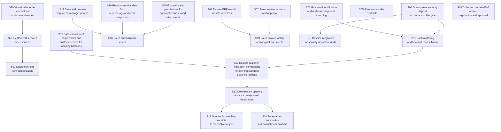

# NanoSpec

NanoSpec turns requirements into self-contained stories for AI to implement and humans to accept.

## Why NanoSpec exists

I don't start a project by asking an agent to build the whole thing and improvising from there. That sort of vibe coding gets harder to control as the project grows. I want a plan before implementation: split the project into phases, then work out the current phase in enough detail to build and review it.

AI can finish tasks faster than I can carefully review their results. My attention is the limit I need to plan around. I want each delivery small enough to inspect, with a clear answer to what was built, how to check it, and what counts as accepted.

NanoSpec splits requirements into Stories, its smallest units of specification, execution, and acceptance. The [concept model](./concept-model.md#story) defines a Story as:

> A result that can be understood, implemented, and accepted on its own, and leaves the system meaningfully further along.

The rules pay close attention to that boundary. Each Story keeps its own complete definition, an acceptance route, observable conditions, and evidence. Another agent can pick it up without reopening the planning conversation. When it comes back, I have one coherent result to review and a concrete acceptance decision to make.

### Why no task layer?

With coding agents improving this quickly, I leave implementation details to the agent working in the current codebase. My attention stays on how the product should behave and what evidence would let me accept it.

That is why NanoSpec has no permanent task layer. The Story defines the business result, its boundaries, and the observable acceptance conditions. The agent reads the current code, makes its own working plan, and revises that plan as implementation progresses.

My review stays with the business behavior: the interactions, API results, and saved state. Required public contracts remain in the Story, and project rules still constrain the implementation.

### Story dependencies

Each Story names the prerequisite results it needs in `depends_on`. NanoSpec generates a dependency graph with execution and acceptance status labels from those declarations and the current Cycle facts. This keeps actual blockers separate from the preferred order of work.

Independent Stories may run in parallel when resources and project conditions allow. A Story waits only for its own prerequisites; graph position does not create an execution batch. Before execution, each prerequisite result must be verified, supported by applicable evidence, and available in the current environment. See [dependency readiness](./execution-rules.md#dependency-readiness).

The example below shows a Cycle spanning sales, finance, and supporting changes. Each arrow points from a prerequisite to the Story that needs its result.

#### Dependency Graph



S06 can proceed once S17, S16, and S15 meet those readiness conditions, even while the invoice or deposit work is unfinished. S05 and S08 have no Story prerequisites in this plan. The graph makes both choices visible without reading every Story first.

## Get started

For a small or midsize project, such as a simple e-commerce site, I usually split the requirements into three to five phases and keep each phase as independent as possible. I use NanoSpec to plan one phase at a time. That phase becomes a Cycle containing a set of Stories.

Requires Go 1.22 or later. From the NanoSpec repository directory:

```sh
go install .
nanospec version
```

The prompts below are adapted from my daily workflow. Adjust the NanoSpec location, document paths, and project tools to match the actual setup. The worktree and `better-playwright` requirements are part of this example's project workflow.

### Plan the current phase

I give the agent both the full requirements and the current phase's requirements. It needs the larger context while planning the current phase in detail.

```text
We need to plan the development specifications (specs) for the current phase.

1. First, read the requirements:
   - Full project requirements: ./docs/develop/*
   - Current phase requirements: ./docs/prd/<package-file>.md
2. Analyze the current code in depth. Thoroughly understand the repository
   structure, key business design, existing behavior, and relevant public
   contracts.
3. Read ~/coding/nanospec/SKILL.md and understand its instructions and how to
   use the system.
4. Prepare a complete set of specs for this phase based on confirmed decisions
   from our discussion, the original requirements, and verified project facts.

All spec writing, checking, and corrections must strictly follow the NanoSpec
system.
Write the specs in English and save them under ./spec/.

Before writing any specs, thoroughly analyze the requirements and the current
state of the project. Most importantly, clearly identify:
- Any ambiguity or unclear expectations, and the key assumptions you have
  made about them.
- Hidden requirements and potential risks.
- Questions that must be clarified to align the requirements.

Do not write specs until these questions have been answered. Investigate
questions that can be answered from the requirements and project code first.

Since the entire phase must be planned in one pass, account for the complete
business flow, constraints, actual dependencies, important exceptions, and
other details needed to achieve the goal.
```

### Execute one Story

Once the phase is planned, I select a Story explicitly. Replace the document-path placeholders in the prompt below with the actual selection.

```text
First, read:
- Project-wide development documentation: ./docs/develop/*
- Requirements for the current phase: <package-NN-*.md>
- <cycle-NN-*/cycle.md>

Then read the Story selected for this run:
- <cycle-NN-*/story-NN-*/story.md>

The goal of this run is to implement this Story:
- Assess whether this Story is ready for development. If its specification or
  prerequisites are insufficient for implementation, identify what needs to
  be adjusted.
- If implementation may cross this Story's defined boundary, stop first and
  explain why. Handle any necessary specification adjustment through
  NanoSpec's specification change rules.
- Follow the Execute section of ~/coding/nanospec/SKILL.md to implement this
  Story.
- Before changing code, create a new worktree for this Story, named
  <project-dir-name>-c<cycle-number>s<story-number>. All subsequent changes
  must be made in that worktree. Also copy the symlinks for files and
  directories such as AGENTS.md, .agents, ai-issue-doc, and agents-rules into
  the new worktree. This is so main and all worktrees share the same rules
  and documents.
- Follow AGENTS.md and NanoSpec's Execute rules throughout the work.
- Update execution state through NanoSpec's checkpoint, evidence, verify,
  accept, and reject commands, following the declared acceptance policy.
  The execution protocol comes from the execution package generated by
  prepare; cycle.md records the current facts.
- If implementation or verification encounters any blocking problem that
  needs to be resolved outside the current goal, such as network or login
  account issues, unreachable APIs, API errors, missing fields, or any
  unexpected request or response results, stop and clearly state the problem
  in plain, concise language.

Verification and delivery requirements:
- For APIs, follow the business flow in order. Obtain and check the actual
  request and response at every step.
- When saving data, query the database to confirm that it was persisted
  correctly. A read API that proves persistence can also provide evidence.
- For UI work, use better-playwright to check layout, buttons, clicks, and
  interactions through the actual interface.
- For a business flow spanning UI, APIs, and persisted data, perform
  end-to-end verification. Use better-playwright's native network monitoring
  to capture live requests and responses. Check the rendered UI against the
  responses, and confirm persistence through a database query or the read
  API described above. Ensure that all three reflect the same operation
  and its result.
- Where conditions allow, perform the full better-playwright verification
  after implementation is complete. Avoid repeatedly performing full UI
  flows during development and consuming large numbers of tokens.
- Provide a manual test entry, including startup commands, access URLs,
  required accounts, and the steps for checking the results.

Before proposing any solution or writing code, analyze the requirements and
how the current project is implemented. Explain your understanding of the
goal, what work is needed to achieve it given the existing implementation,
and the gap between the two.

Most importantly, clearly identify any ambiguity, unclear expectations, or
key assumptions you have made. List the questions that must be clarified to
align the requirements. The purpose of this step is to let me confirm that
your understanding matches my intent and expose anything missing or unclear
in the requirements.

Complete all of the above analysis first, then provide the full analysis and
questions requiring clarification in one response. Do not ask me questions
partway through.
```

English is the default. A request such as `Spec language: Japanese (Japan), ja-JP` changes the document language. The choice is stored in `cycle.md` as `spec_language` and carried into execution packages. Existing Cycles keep their recorded language unless explicitly changed.

Headings and field names are fixed English keywords. Their spelling, case, and spacing stay the same. Natural-language field values, descriptions, and diagram labels use the selected language. Product UI language, currency, time zone, and local business rules need their own requirements. [Language rules](./concept-model.md#spec-language).

## How the work is organized

A **Story** is one result that can be understood, implemented, and accepted on its own. It includes the full definition, an acceptance route, and observable acceptance conditions with stable IDs.

A **Cycle** groups Stories, records their dependencies, and puts work in a useful order. It does not hold requirements that a Story needs to borrow to make sense.

Each Story starts with a short title and a concrete scenario. The full definition follows. An optional implementation brief passes on repository findings worth keeping; the executing agent still checks the current code and chooses the implementation.

A typical layout:

```text
spec/
  cycle-01-orders/
    cycle.md
    story-01-save-order/
      story.md
      implementation-brief.md
      acceptance/
        evidence.md
        evidence/
    story-02-order-history/
      story.md
```

The project can choose another spec root. `implementation-brief.md` is optional. While work is underway, observations go in `acceptance/evidence.md`. On acceptance, that record becomes `acceptance/outcome.md`. The two records never coexist. Screenshots, responses, query results, and reports stay in `acceptance/evidence/`.

Artifact paths are relative to `acceptance/`, for example `evidence/order.png`. Shared material can point to the Story that owns it. Keep one acceptance conclusion for each Story.

## From requirements to execution

1. Read the project rules, source requirements, and current code. Set the spec language.
2. Find the independently deliverable results and their actual prerequisites.
3. Write `cycle.md` with planning and execution facts, and each `story.md`. Add an implementation brief only when it saves worthwhile investigation.
4. Run `nanospec validate --sync-views <cycle-dir>` and resolve the diagnostics.
5. Have a separate review context read the original requirements, relevant project facts, and the complete first draft. Fix the findings and check the affected material again.
6. Select a Story explicitly and run `nanospec prepare <story-dir>` before execution.

Later changes follow the [review scope](./splitting-checklist.md#review-scope). A wording fix or state update does not need a fresh independent review of the whole Cycle.

## What the CLI owns

```text
prepare -> checkpoint -> evidence -> verify -> accept
                                      |
                                    reject -> evidence -> checkpoint -> verify
```

The CLI assembles context, checks startup conditions, records recovery points, versions evidence, separates verification from acceptance, and freezes accepted results.

The agent or caller still chooses the work, checks the real environment, implements it, and judges whether the evidence supports the business result. Human acceptance is the default. Acceptance based on verification requires an explicit authorization recorded in the Story.

NanoSpec has no model runner, task scheduler, sandbox, or code executor. The protocol works with the coding agent already in use.

Writes to the same Cycle wait for one another. Each command reads the latest state after acquiring its turn, then validates and saves. This covers checkpoints, revisions, evidence, reviews, rejections, acceptance, and view synchronization. Directory aliases resolve to the same lock. A wait longer than 10 seconds returns an error without overwriting another write.

## CLI

### Validate and regenerate views

```sh
nanospec validate <cycle-dir>
nanospec validate --sync-views <cycle-dir>
```

Both commands accept one Cycle. Omit the path to use the current directory.

The first command is read-only. The second rebuilds the dependency graph and status labels from Story `depends_on`, Active Lanes, and Acceptance Status in `cycle.md`. It validates the complete result before saving. Errors leave files untouched. Repeating synchronization with unchanged input writes nothing.

Every Story appears, including isolated nodes. Titles come from `Orientation/Title`; redundant dependency edges are omitted. Each node starts with one bracketed status: pending, active, ready, rejected, rework, blocked, or accepted. Only `accepted` means the result has an Outcome. The labels and colors do not establish evidence or acceptance.

Planning Context keeps priorities and coordination notes. Updating the graph and derived Cycle summary preserves that prose, `spec_rev`, and `last_updated_at`; it does not create a new specification revision.

Synchronization already includes full validation. A second read-only run is unnecessary unless something changed.

### Read the plan

```sh
nanospec show overview <cycle-dir>
nanospec show graph <cycle-dir>
nanospec ready <cycle-dir>
```

`overview` collects Story titles, current states, and scenarios in dependency order. It gives a quick view of the work without copying definitions or acceptance conditions.

`ready` lists all unassigned `pending` or `rejected` Stories whose recorded prerequisites are `ready` or `accepted`. Candidates appear in stable Story ID order. It does not choose work or start it. Evidence applicability, environment availability, and any required human approval still need to be checked.

### Prepare the selected work

```sh
nanospec prepare <story-dir-or-story.md>...
nanospec prepare --json <story-dir-or-story.md>...
```

Preparation includes only the explicit selection. Each package contains the specification revision, spec language, acceptance state, dependency states, startup condition, and confirmations still needed at the project site. Markdown includes `Spec Language`; JSON includes `spec_language`, the current Story `status`, and its `resume_status` when blocked in the `nanospec.prepare.v1` envelope. An omitted Cycle language resolves to `en-US`.

The package includes the execution rules embedded in the same CLI build. Hand this package to the executing agent instead of a bare Story or state file. Project rules and live code still come from the target project.

`ready_for_confirmation` means the recorded states allow further checks. `waiting_for_selected_dependency` means a prerequisite was selected in the same request but must reach `ready` or `accepted` first. A recorded blocker returns a `blocked` gate and a nonzero status with its package intact. Read the cause and recovery target before proceeding. Unselected prerequisites that are not ready, open questions, pending acceptance, and already accepted work also return a nonzero status. Selection never implies that every item starts at once.

A Story with `regression_of` also receives the referenced definition and Outcome as frozen context. Content digests detect changes to the accepted Story. Historical external human acceptance records with missing artifact locations and evidence context can be included only under the documented checks, with a warning. Their original text is kept; their conclusions do not replace current evidence. [Change rules](./spec-change-rules.md).

### Check the execution baseline

Keep `spec_revision` from the execution package. Pass that exact value as `--spec-revision` to every checkpoint, evidence, verification, acceptance, or rejection command. A command checks it after acquiring the Cycle lock and refuses a stale version without changing records. Preparation and writes do not require an external coordinator.

After a mismatch, prepare again and assess the changed definition, prerequisite results, implementation, and evidence. Do not simply substitute the latest number. Unaffected evidence can continue after assessment; changed conditions need fresh observations. Check before a new implementation stage, before changing shared contracts, and before verification or acceptance. An external notification may bring the check forward, but cannot replace it.

### Save a checkpoint

```sh
nanospec checkpoint --spec-revision <rev-N> --owner <executor-id> --status active \
  --next "<next action>" --situation "<current fact>" <story>
```

Checkpoint status is pending, active, ready, rejected, rework, or blocked. It must follow the recorded stage: first work starts active, a rejected result starts repair with rework, and ready/accepted are established by verification/acceptance. A blocked checkpoint requires `--issue` and a recovery action, and preserves its prior stage as Resume Status. Resolve the cause and restore that stage; restoring ready also requires current passed evidence.

Use `--complete --next none` to mark implementation complete in active or rework. Self-checks still run in that stage; only a passed verification reaches ready. Rejection waits for an actual repair assignment and cannot be skipped by recording evidence. Active, rework, and ready recovery require resolved Open Questions and ready or accepted prerequisites.

Each Story has one Lane. `Owner` identifies the executor responsible for continuing it. It uses the same identifier format as `implemented_by`, for example `finance-a`, with no spaces. Ownership can change before evidence exists. Once `acceptance/evidence.md` exists, a direct Owner change is rejected. The original Owner can continue recording evidence.

### Record a semantic revision

Edit the requirements baseline, Story, and affected relationships first. Then list every affected Story in the same Cycle:

```sh
nanospec revise --reason "<semantic change>" <affected-story>...
```

The command validates the edited specification, synchronizes generated views, increments the Cycle revision once, and invalidates the affected acceptance facts. Unstarted work stays pending, existing rejections still wait for an assignment, and started work records its recovery stage. Started affected Lanes gain one spec-change event and a recovery action to reassess the new baseline. Current rejections and existing blockers are preserved. All in-progress evidence moves to the new Cycle revision; only explicitly affected evidence becomes stale. Removed or renamed Acceptance IDs drop from the affected in-progress record.

The command records the revision. It does not write the Story or infer the affected set.

### Record observations and review them

```sh
nanospec evidence --spec-revision <rev-N> --implemented-by <executor-id> --acceptance A1 \
  --observed "<observed result>" --command "<command or none: manual observation>" \
  --result "<actual result>" --artifacts "<artifact path>" \
  --context '{"spec_revision":"<rev-N>","code_revision":"<full-Git-commit-or-sha256:digest>","environment":"<entry>","observed_at":"<ISO-8601>"}' <story>

nanospec checkpoint --spec-revision <rev-N> --owner <executor-id> --status active --complete \
  --next none --situation "<implementation result>" <story>

nanospec verify --spec-revision <rev-N> --verified-by <executor-id> --mode self --result pass <story>
nanospec verify --spec-revision <rev-N> --verified-by <reviewer-id> --mode independent --result rework <story>
```

Evidence must reference an existing Acceptance ID and match the Lane Owner. Recording the same ID replaces that item's current observation. Stale evidence needs a fresh observation.

`pass` requires complete, current evidence and a complete implementation checkpoint, then moves acceptance to `ready`. `rework` adds one return-to-implementation round and sets the Story to rejected; repair starts only after an explicit rework checkpoint. Self review requires the implementer and verifier to match. Independent review requires different identities. Neither review mode makes the final acceptance decision.

Before a passed review or final acceptance, the CLI rechecks open questions and prerequisite states. A prerequisite returning to `pending` or being rejected blocks the action. Acceptance also checks that `story.md` still matches the prepared content before freezing it.

`--context` is one JSON object with `spec_revision`, `code_revision`, `environment`, and `observed_at`. The revision must equal `--spec-revision`; the code reference is a full 40-digit Git commit or `sha256:` followed by 64 hexadecimal digits. Environment is a non-empty entry or working directory, and observation time is ISO-8601 with a timezone. Missing fields, unknown fields, references, and trailing values are rejected.

`Verification Context:` summarizes the latest recorded observation. Every Acceptance item stores its own complete JSON context in `Evidence Context`. Updating the summary preserves each item's original values. These keys and record labels are fixed English; environment labels follow the spec language and actual entries retain their original text. Keep raw commands and observed output in their original form.

### Accept or reject

Run acceptance only after the required authority has been established:

```sh
nanospec accept --spec-revision <rev-N> --accepted-by <acceptor-id> --method human <story>
nanospec accept --spec-revision <rev-N> --accepted-by <executor-id> --method verified <story>
nanospec reject --spec-revision <rev-N> --rejected-by <acceptor-id> --reason "<observed problem>" <story>
```

Acceptance requires a passed review at the current revision. `verified` also requires the Story's authorization, scope, coverage review, and independent verification. On success, evidence becomes Outcome, the Lane is removed, and progress updates. The last accepted Story completes the Cycle. A failed write restores the original records.

Rejection applies to a delivery whose checks passed. If that ready result is currently blocked, the rejection preserves the blocker and sets its recovery target to rejected. It records the decision, returns evidence for rework, adds one rework round, and records the rejection. A new observation returns acceptance to `pending`.

## Rules and templates

| File | Purpose |
| --- | --- |
| [Concept model](./concept-model.md) | Objects, boundaries, language, and completion |
| [Decomposition rules](./decomposition-rules.md) | Story boundaries, dependencies, and planning |
| [Rule selection](./rule-selection-rules.md) | Applicable business rules and local snapshots |
| [Execution rules](./execution-rules.md) | Context, implementation, evidence, and state |
| [Review checklist](./splitting-checklist.md) | Semantic questions the CLI cannot answer |
| [Change rules](./spec-change-rules.md) | Revisions, new work, and frozen results |
| [Feedback rules](./feedback-loop-rules.md) | Changes to the method itself |
| [Cycle template](./cycle-spec-template.md) | Planning and coordination |
| [Story template](./story-spec-template.md) | The complete authoring interface for one Story |
| [Implementation brief](./implementation-brief-template.md) | Optional repository findings |
| [Outcome template](./outcome-record-template.md) | Frozen acceptance evidence |

Each rules file owns its subject. The concept model settles semantic conflicts. Templates keep the format and the guidance needed to fill it in one place. The CLI implements the stable checks that can be made mechanically; it does not add requirements of its own.

`ERROR` blocks validation. `WARN` asks for review or cleanup without blocking. An empty optional section is a cleanup warning. Structural checks cannot establish that authorization is real, evidence is sufficient, or a business result is correct.

## Working on NanoSpec

`main.go` embeds the execution rules. `internal/cli/` handles commands and output. `internal/validator/` owns validation, views, context, and state changes. `internal/specdoc/` reads frontmatter and Markdown.

Use the current source while changing the tool:

```sh
go run . <command>
go test ./...
go test -race ./...
go vet ./...
go install .
```

`nanospec version` reports the build, protocol identity, and embedded-rule digest. Keep generated binaries and machine-specific build files out of the repository.
