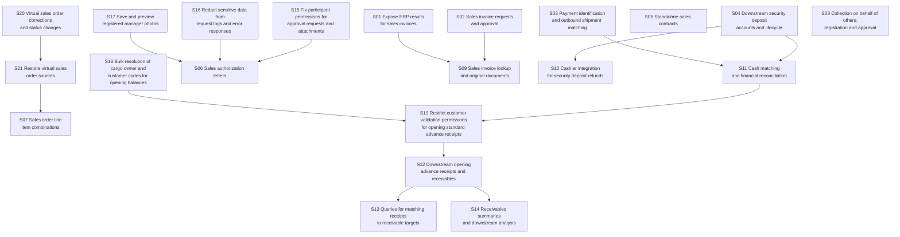

# NanoSpec

NanoSpec turns requirements into self-contained stories for AI to implement and humans to accept.

## Why NanoSpec exists

I don't start a project by asking an agent to build the whole thing and improvising from there. That sort of vibe coding gets harder to control as the project grows. I want a plan before implementation: split the project into phases, then work out the current phase in enough detail to build and review it.

AI can finish tasks faster than I can carefully review their results. My attention is the limit I need to plan around. I want each delivery small enough to inspect, with a clear answer to what was built, how to check it, and what counts as accepted.

NanoSpec splits requirements into Stories, its smallest units of specification, execution, and acceptance. The [concept model](./concept-model.md#story) defines a Story as:

> A result that can be understood, implemented, and accepted on its own, and leaves the system meaningfully further along.

The rules pay close attention to that boundary. Each Story keeps its own complete definition, an acceptance route, observable conditions, and evidence. Another agent can pick it up without reopening the planning conversation. When it comes back, I have one coherent result to review and a concrete acceptance decision to make.

### Why no task layer?

With coding agents improving this quickly, I leave implementation details to the agent working in the current codebase. My attention stays on how the product should behave and what evidence would let me accept it.

That is why NanoSpec has no permanent task layer. The Story defines the business result, its boundaries, and the observable acceptance conditions. The agent reads the current code, makes its own working plan, and revises that plan as implementation progresses.

My review stays with the business behavior: the interactions, API results, and saved state. Required public contracts remain in the Story, and project rules still constrain the implementation.

### Story dependencies

Each Story names the prerequisite results it needs in `depends_on`. NanoSpec generates a dependency graph and Dependency Waves from those declarations. This keeps actual blockers separate from the preferred order of work.

Stories in the same Wave have no dependency path between them and may run in parallel when resources and project conditions allow. A Story waits only for its own prerequisites, so unrelated work in an earlier Wave can remain unfinished. Before execution, each prerequisite result must be verified, supported by applicable evidence, and available in the current environment. See [dependency readiness](./execution-rules.md#dependency-readiness).

This Cycle spans sales, finance, and supporting changes. Each arrow points from a prerequisite to the Story that needs its result.

#### Dependency Graph



S06 can proceed once S17, S16, and S15 meet those readiness conditions, even while the invoice or deposit work is unfinished. S05 and S08 have no Story prerequisites in this plan. The graph makes both choices visible without reading every Story first.

## Get started

For a small or midsize project, such as a simple e-commerce site, I usually split the requirements into three to five phases and keep each phase as independent as possible. I use NanoSpec to plan one phase at a time. That phase becomes a Cycle containing a set of Stories.

Requires Go 1.22 or later. From the NanoSpec repository directory:

```sh
go install .
nanospec version
```

The prompts below are adapted from my daily workflow. They assume NanoSpec is available at `./nanospec/` from the project root, as a local checkout or symlink. Replace the document paths, initial reply language, and project tools to match the actual setup. The worktree and `better-playwright` requirements are part of this example's project workflow.

### Plan the current phase

I give the agent both the full requirements and the current phase's requirements. It needs the larger context while planning the current phase in detail.

```text
We need to plan the development specifications for the current phase.

1. Read the requirements:
   - Full project requirements: <path-or-URL>
   - Current phase requirements: <path-or-URL>
2. Analyze the current code in depth. Understand the repository structure,
   key business design, existing behavior, and relevant public contracts.
3. Read ./nanospec/SKILL.md and the rules it selects for writing specs.
4. Use the confirmed decisions from our discussion and the checked project
   facts to prepare a complete set of specs for this phase.

Spec language: en-US
Rule sources: <explicit source paths, or []>
Spec directory: ./spec/cycle-01-orders/

Before writing any specs, analyze the requirements and actual project.
Report:
- Any ambiguity, unclear expectation, or critical assumption.
- Hidden requirements and likely risks.
- Questions that need an answer to align the requirements.
- Any gap in NanoSpec itself that prevents a clear specification of this work.

Investigate questions that can be answered from the repository. Do not draft
the specs until the required clarifications have been answered.

Plan the complete current phase after clarification. Account for the details
needed for independent implementation and acceptance: participants, entries,
objects, business rules, dependencies, defaults, important non-success cases,
and observable results.

Write, check, and repair the specs through NanoSpec's rules and templates.
Keep every Story self-contained. Validate and synchronize the Cycle, then
complete the required independent review and resolve its findings.
```

### Execute one Story

Once the phase is planned, I select a Story explicitly. This example uses `story-01-save-order` in `cycle-01-orders`.

```text
Read:
- Full project requirements: <path-or-URL>
- Current phase requirements: <path-or-URL>
- ./nanospec/SKILL.md, especially Execute
- ./spec/cycle-01-orders/cycle.md
- ./spec/cycle-01-orders/execution-state.md
- ./spec/cycle-01-orders/story-01-save-order/story.md

The target is story-01-save-order.

Before proposing a solution or writing code, analyze the requirements and
current implementation. Reply in Chinese with:
- The goal as understood from the requirements.
- What the current implementation already provides.
- The work needed to reach the goal and the gaps that remain.
- Any ambiguity, unclear expectation, or critical assumption.
- Questions that must be answered to align the requirements.

Give me enough detail to confirm the understanding and fill any requirements
gaps. Investigate repository questions first. Resolve required human decisions
before implementation.

Implementation:
- Assess whether this Story is ready to develop. If the specification or its
  prerequisites are insufficient, explain what needs to change.
- Before editing project files, create a fresh Git worktree. Name its directory
  <project-dir-name>-c<cycle-number>s<story-number>, for example shop-c1s1.
  Keep all subsequent edits and verification in that worktree.
- Carry over the required project files and symlinks, including AGENTS.md,
  .agents, and nanospec where applicable. Preserve symlinks and check that
  their targets still resolve from the new worktree.
- From that worktree, run:
  nanospec prepare ./spec/cycle-01-orders/story-01-save-order
  Use the resulting execution package as the execution input. Check its
  prerequisite states, evidence applicability, and environment availability.
- Follow AGENTS.md and NanoSpec's Execute rules throughout the work.
- Keep execution state current through NanoSpec's lifecycle commands:
  checkpoint, evidence, verify, accept, and reject. Follow the declared
  acceptance policy. The execution protocol comes from the prepared package;
  execution-state.md records the current facts.
- Stop before an implementation would cross this Story's defined boundary.
  Explain the reason. Handle any specification change through NanoSpec's
  change rules before continuing.
- For blockers outside this Story's scope, stop and explain the problem in
  plain, concise language. Examples include network failures, unusable login
  accounts, unreachable APIs, missing response fields, or unexpected requests
  and responses that prevent implementation or verification.

Verification and delivery:
- For APIs, follow the business flow in order. Capture and check the actual
  request and response at every step.
- For persistence, query the database to confirm the saved data. A read API
  that proves the data was persisted can also provide that evidence.
- For UI work, use better-playwright to check layout, buttons, clicks, and
  interactions through the actual interface.
- For a flow spanning UI, APIs, and stored data, verify it end to end. Use
  better-playwright's native network monitoring to capture live requests and
  responses. Compare the response with the rendered UI and check persisted
  state through a database query or the read API described above. Confirm
  that they all reflect the same action and result.
- Where possible, run the full better-playwright verification after the
  implementation is complete. Avoid repeatedly running the full UI flow
  during development and spending tokens on the same checks.
- Follow the Story's Acceptance Flow and record evidence for each Acceptance
  ID. Complete the required review and delivery under its acceptance policy.
- Provide a manual test entry: startup commands, access URLs, required
  accounts, and the steps needed to inspect the result.
```

English is the default. A request such as `Spec language: Japanese (Japan), ja-JP` changes the document language. The choice is stored in `cycle.md` as `spec_language` and carried into execution packages. Existing Cycles keep their recorded language unless explicitly changed.

Headings and field names are fixed English keywords. Their spelling, case, and spacing stay the same. Natural-language field values, descriptions, and diagram labels use the selected language. Product UI language, currency, time zone, and local business rules need their own requirements. [Language rules](./concept-model.md#spec-language).

## How the work is organized

A **Story** is one result that can be understood, implemented, and accepted on its own. It includes the full definition, an acceptance route, and observable acceptance conditions with stable IDs.

A **Cycle** groups Stories, records their dependencies, and puts work in a useful order. It does not hold requirements that a Story needs to borrow to make sense.

Each Story starts with a short title and a concrete scenario. The full definition follows. An optional implementation brief passes on repository findings worth keeping; the executing agent still checks the current code and chooses the implementation.

A typical layout:

```text
spec/
  cycle-01-orders/
    cycle.md
    execution-state.md
    story-01-save-order/
      story.md
      implementation-brief.md
      acceptance/
        evidence.md
        evidence/
    story-02-order-history/
      story.md
```

The project can choose another spec root. `implementation-brief.md` is optional. While work is underway, observations go in `acceptance/evidence.md`. On acceptance, that record becomes `acceptance/outcome.md`. The two records never coexist. Screenshots, responses, query results, and reports stay in `acceptance/evidence/`.

Artifact paths are relative to `acceptance/`, for example `evidence/order.png`. Shared material can point to the Story that owns it. Keep one acceptance conclusion for each Story.

## From requirements to execution

1. Read the project rules, source requirements, and current code. Set the spec language.
2. Find the independently deliverable results and their actual prerequisites.
3. Write `cycle.md`, each `story.md`, and `execution-state.md`. Add an implementation brief only when it saves worthwhile investigation.
4. Run `nanospec validate --sync-views <cycle-dir>` and resolve the diagnostics.
5. Have a separate review context read the original requirements, relevant project facts, and the complete first draft. Fix the findings and check the affected material again.
6. Select a Story explicitly and run `nanospec prepare <story-dir>` before execution.

Later changes follow the [review scope](./splitting-checklist.md#review-scope). A wording fix or state update does not need a fresh independent review of the whole Cycle.

## What the CLI owns

```text
prepare -> checkpoint -> evidence -> verify -> accept
                                      |
                                    reject -> evidence -> checkpoint -> verify
```

The CLI assembles context, checks startup conditions, records recovery points, versions evidence, separates verification from acceptance, and freezes accepted results.

The agent or caller still chooses the work, checks the real environment, implements it, and judges whether the evidence supports the business result. Human acceptance is the default. Acceptance based on verification requires an explicit authorization recorded in the Story.

NanoSpec has no model runner, task scheduler, sandbox, or code executor. The protocol works with the coding agent already in use.

Writes to the same Cycle wait for one another. Each command reads the latest state after acquiring its turn, then validates and saves. This covers checkpoints, revisions, evidence, reviews, rejections, acceptance, and view synchronization. Directory aliases resolve to the same lock. A wait longer than 10 seconds returns an error without overwriting another write.

## CLI

### Validate and regenerate views

```sh
nanospec validate <cycle-dir>
nanospec validate --sync-views <cycle-dir>
```

Both commands accept one Cycle. Omit the path to use the current directory.

The first command is read-only. The second rebuilds Dependency Waves and the dependency graph from `depends_on`, and the progress tree from acceptance states. It validates the complete result before saving. Errors leave the files untouched. Repeating a synchronization with unchanged input writes nothing.

Within a Wave, existing relative order stays intact. Coordination notes can follow the Story on the same line after a semicolon or in paragraphs below it. Notes move with the Story and stay out of graph labels. The rest of the documents, `spec_rev`, and `last_updated_at` are preserved. Regenerating a view does not create a new revision.

On the first draft, an ordered list of all Story IDs is enough; Wave headings and titles can be generated. The titles come from each Story's `Orientation/Title`. A dependency already implied by another path produces a cleanup warning and is omitted from the graph.

Synchronization already includes full validation. A second read-only run is unnecessary unless something changed.

### Read the plan

```sh
nanospec show overview <cycle-dir>
nanospec show waves <cycle-dir>
nanospec show graph <cycle-dir>
nanospec show tree <cycle-dir>
nanospec ready <cycle-dir>
```

`overview` collects Story titles and scenarios in Wave order. It gives a quick view of the work without copying definitions or acceptance conditions.

`ready` lists all unassigned `pending` or `rejected` Stories whose recorded prerequisites are `ready` or `accepted`. It respects Wave order and the order inside each Wave. It does not choose work or start it. Evidence applicability, environment availability, and any required human approval still need to be checked.

### Prepare the selected work

```sh
nanospec prepare <story-dir-or-story.md>...
nanospec prepare --json <story-dir-or-story.md>...
```

Preparation includes only the explicit selection. Each package contains the specification revision, spec language, acceptance state, dependency states, startup condition, and confirmations still needed at the project site. Markdown includes `Spec Language`; JSON includes `spec_language` in the `nanospec.prepare.v1` envelope. An omitted Cycle language resolves to `en-US`.

The package includes the execution rules embedded in the same CLI build. Hand this package to the executing agent instead of a bare Story or state file. Project rules and live code still come from the target project.

`ready_for_confirmation` means the recorded states allow further checks. `waiting_for_selected_dependency` means a prerequisite was selected in the same request but must reach `ready` or `accepted` first. Unselected prerequisites that are not ready, open questions, pending acceptance, and already accepted work return a nonzero status. Selection never implies that every item starts at once.

A Story with `regression_of` also receives the referenced definition and Outcome as frozen context. Content digests detect changes to the accepted Story. Historical external human acceptance records with missing artifact locations and evidence context can be included only under the documented checks, with a warning. Their original text is kept; their conclusions do not replace current evidence. [Change rules](./spec-change-rules.md).

### Save a checkpoint

```sh
nanospec checkpoint --owner <executor-id> --status active \
  --next "<next action>" --situation "<current fact>" <story>
```

Checkpoint status is `active`, `paused`, `blocked`, or `done`. `blocked` requires `--issue`. `done` requires `--next none`. Except for a blocked checkpoint, open questions must be clear and prerequisites must be `ready` or `accepted`.

Each Story has one Lane. `Owner` identifies the executor responsible for continuing it. It uses the same identifier format as `implemented_by`, for example `finance-a`, with no spaces. Ownership can change before evidence exists. Once `acceptance/evidence.md` exists, a direct Owner change is rejected. The original Owner can continue recording evidence.

### Record a semantic revision

Edit the requirements baseline, Story, and affected relationships first. Then list every affected Story in the same Cycle:

```sh
nanospec revise --reason "<semantic change>" <affected-story>...
```

The command validates the edited specification, synchronizes generated views, increments the Cycle revision once, and returns affected Stories to `pending`. Started Lanes gain one spec-change event. All in-progress evidence moves to the new Cycle revision; only explicitly affected evidence becomes stale. Removed or renamed Acceptance IDs drop from the affected in-progress record.

The command records the revision. It does not write the Story or infer the affected set.

### Record observations and review them

```sh
nanospec evidence --implemented-by <executor-id> --acceptance A1 \
  --observed "<observed result>" --command "<command or none: manual observation>" \
  --result "<actual result>" --artifacts "<artifact path>" \
  --context "<revision, code, environment, and time>" <story>

nanospec checkpoint --owner <executor-id> --status done \
  --next none --situation "<implementation result>" <story>

nanospec verify --verified-by <executor-id> --mode self --result pass <story>
nanospec verify --verified-by <reviewer-id> --mode independent --result rework <story>
```

Evidence must reference an existing Acceptance ID and match the Lane Owner. Recording the same ID replaces that item's current observation. Stale evidence needs a fresh observation.

`pass` requires complete, current evidence and a done checkpoint, then moves acceptance to `ready`. `rework` adds one rework round and returns acceptance to `pending`. Self review requires the implementer and verifier to match. Independent review requires different identities. Neither review mode makes the final acceptance decision.

Before a passed review or final acceptance, the CLI rechecks open questions and prerequisite states. A prerequisite returning to `pending` or being rejected blocks the action. Acceptance also checks that `story.md` still matches the prepared content before freezing it.

Shared verification background uses `Verification Context:`. The label is fixed English; its value follows the spec language. Keep raw commands and observed output in their original form.

### Accept or reject

Run acceptance only after the required authority has been established:

```sh
nanospec accept --accepted-by <acceptor-id> --method human <story>
nanospec accept --accepted-by <executor-id> --method verified <story>
nanospec reject --rejected-by <acceptor-id> --reason "<observed problem>" <story>
```

Acceptance requires a passed review at the current revision. `verified` also requires the Story's authorization, scope, coverage review, and independent verification. On success, evidence becomes Outcome, the Lane is removed, and progress updates. The last accepted Story completes the Cycle. A failed write restores the original records.

Rejection applies to a `ready` delivery. It records the decision, returns evidence for rework, adds one rework round, and pauses the Lane. A new observation returns acceptance to `pending`.

## Rules and templates

| File | Purpose |
| --- | --- |
| [Concept model](./concept-model.md) | Objects, boundaries, language, and completion |
| [Decomposition rules](./decomposition-rules.md) | Story boundaries, dependencies, and planning |
| [Rule selection](./rule-selection-rules.md) | Applicable business rules and local snapshots |
| [Execution rules](./execution-rules.md) | Context, implementation, evidence, and state |
| [Review checklist](./splitting-checklist.md) | Semantic questions the CLI cannot answer |
| [Change rules](./spec-change-rules.md) | Revisions, new work, and frozen results |
| [Feedback rules](./feedback-loop-rules.md) | Changes to the method itself |
| [Cycle template](./cycle-spec-template.md) | Planning and coordination |
| [Story template](./story-spec-template.md) | The complete authoring interface for one Story |
| [Implementation brief](./implementation-brief-template.md) | Optional repository findings |
| [Execution state](./execution-state-template.md) | Recovery and acceptance state |
| [Outcome template](./outcome-record-template.md) | Frozen acceptance evidence |

Each rules file owns its subject. The concept model settles semantic conflicts. Templates keep the format and the guidance needed to fill it in one place. The CLI implements the stable checks that can be made mechanically; it does not add requirements of its own.

`ERROR` blocks validation. `WARN` asks for review or cleanup without blocking. An empty optional section is a cleanup warning. Structural checks cannot establish that authorization is real, evidence is sufficient, or a business result is correct.

## Working on NanoSpec

`main.go` embeds the execution rules. `internal/cli/` handles commands and output. `internal/validator/` owns validation, views, context, and state changes. `internal/specdoc/` reads frontmatter and Markdown.

Use the current source while changing the tool:

```sh
go run . <command>
go test ./...
go test -race ./...
go vet ./...
go install .
```

`nanospec version` reports the build, protocol identity, and embedded-rule digest. Keep generated binaries and machine-specific build files out of the repository.
