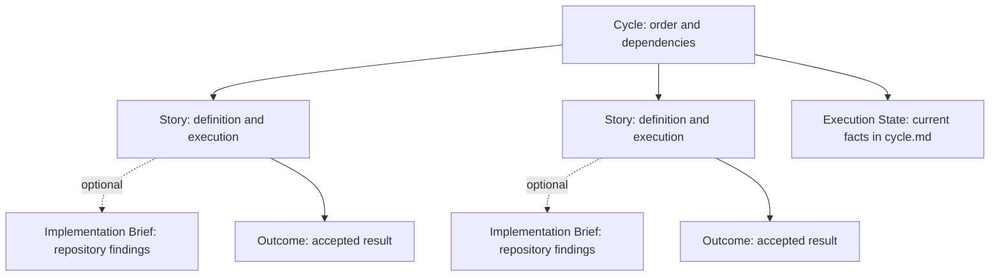

# Concept Model

This file defines NanoSpec's objects and their boundaries. If a rule, template, or validator disagrees with it, fix that file.

## 1. Working assumptions

NanoSpec supports a handoff:

1. Read the requirements and project, then write a spec.
2. Explicitly select one or more Stories and run `nanospec prepare` for each.
3. Another agent uses the execution package, project rules, and current code to understand and carry out the work.
4. The agent implements and verifies the result. Acceptance follows the method agreed in advance, with human acceptance as the default.

The next agent should not need the planning conversation or the author's memory. It can investigate the repository and use the project's tools. The execution package brings together the stable definition, current state, dependencies, rules, and startup conditions for the selected work.

A spec keeps requirements, boundaries, business rules, acceptance conditions, and confirmed decisions. An optional brief keeps repository findings that are expensive to rediscover. The executing agent chooses implementation steps from the code as it exists at that time.

The aim is a result small enough for one agent to handle, clear enough for a person to accept, and structured enough to check. Structural validation cannot settle business judgment. Correctness still depends on the actual requirements, project facts, observed results, and acceptance decision.

### Spec language

`spec_language` selects the document language and regional usage. Store it in the frontmatter of `cycle.md`. A clear language name or tag is valid: `American English`, `en-US`, `Japanese`, `ja-JP`, `Brazilian Portuguese`, or `pt-BR`. The default is American English, `en-US`. Write that value when creating a Cycle without another language request.

Use the explicit instruction first, then the existing Cycle's language, then the default. A Cycle without this field reads as `en-US`. Do not infer the language from the conversation, requirements, rule files, or machine environment. Ask when a country alone leaves the language unclear or when instructions conflict.

The setting applies to new and edited prose in the Cycle, Stories, implementation briefs, state explanations, and acceptance records. That includes title values, scenarios, rules, decisions, expected results, and diagram labels. Use the target language naturally. Keep the facts, conditions, strength of requirements, and meaning of business terms intact.

- NanoSpec headings and field names are fixed English keywords. Preserve their spelling, case, and spacing. Examples include `Orientation`, `Title`, `Scenario`, `Acceptance`, and `Verification Context`.
- Natural-language field values use the selected language. Enums, IDs, filenames, commands, paths, and code identifiers stay unchanged. Fixed values such as `pending` and `none` are not translated.
- `『』` marks objects and `「」` marks actions. Their contents use the selected language. Ordinary punctuation and sentence order follow that language. Parallel objects may share one pair of markers.
- Preserve exact UI text, proper names, public contracts, raw observations, and command output when quoting them. Explain them in the selected language if needed. Translate the local body of an applicable rule; keep its ID and source.
- Template instructions and examples guide the writing. Adapt them to the selected language rather than copying them unchanged. CLI labels and fixed state summaries use the protocol's English text.
- Document language does not choose the product's UI language, currency, time zone, date format, or local business rules. Define those requirements in the Story.

`nanospec prepare` carries the resolved language into every execution package. Continue using it for revisions and execution records. A translation that preserves meaning does not increment `spec_rev`. Accepted Stories, briefs, and Outcomes stay frozen. A translation that changes behavior follows the change rules.

The CLI checks that the language setting is nonempty text. Language choice and translation quality are part of semantic review.

## 2. Core objects

### Cycle

A Cycle groups a set of Stories for planning and coordination. It records the work in the group, actual blocking dependencies, possible parallel work, and the preferred order when resources are limited.

Each Story keeps its own complete requirements. Check the actual code, data, and behavior when planning the Cycle. `depends_on` refers only to Stories in that Cycle. When using an existing feature, explain the confirmed behavior and connection in the current Story's Definition.

The Dependency Graph shows every Story, its current execution or acceptance state, and the dependency edges not already implied by another path. The CLI derives it from Story `depends_on`, Acceptance Status, and Active Lanes in `cycle.md`. Graph edits do not change those facts. Isolated Stories remain visible.

Planning Context records a useful priority or coordination constraint without creating a dependency. Graph position does not impose an execution batch. A Story can start when its own prerequisites are ready and available, subject to the caller's selection and project constraints.

A prerequisite is ready when its result has been verified, its evidence still applies, and the result is available in the current environment. It need not already be accepted unless explicit human confirmation is required. See [dependency readiness](./execution-rules.md#dependency-readiness).

`nanospec validate --sync-views` regenerates the graph from the current facts. Acceptance facts remain in Acceptance Status and the acceptance records. A generated graph supplies neither a decision nor evidence.

Entirely unstarted Stories may be repartitioned without changing their combined acceptance meaning. A `Repartition Record` keeps the old and new IDs and a complete Acceptance mapping. It is a trace record, not a second requirements source. New, removed, or changed acceptance meaning follows the ordinary revision process.

### Story

A Story is the smallest formal unit of specification, execution, and acceptance:

> A result that can be understood, implemented, and accepted on its own, and leaves the system meaningfully further along.

Most Stories describe business results. Migrations, project setup, logging, permissions, shared state machines, and system-wide regression work can also be Stories when their result can be accepted independently.

Draw the boundary around how the result actually happens. Identify the roles, entry points, system areas, data, and state involved. Every necessary part must be supplied by the current Story, a confirmed existing feature, or a prerequisite Story.

Enhancements and variants that can ship independently usually become later Stories. Permissions, data integrity, security, and compliance required for a valid delivery cannot be postponed as optional improvements.

A Story contains:

- `Orientation`: the human entry point. `Title` is the official title. `Scenario` follows one concrete event from its trigger through the system's response to the result and its later use.
- `Definition`: the complete requirements for this result.
  - `Concepts`: business terms a competent developer or tester may still need explained.
  - `Description`: the result, the problem it solves, its business value, process, entry points, objects, defaults, and relationship to the existing system.
  - `Business Logic`: confirmed rules that determine the result and cannot be uniquely inferred from Description.
    - `State Model`: state transitions, when useful.
    - `Flow Diagram`: a process diagram, when it reduces ambiguity.
    - `Constraints`: limits on plausible but wrong extrapolations.
  - `UI Draft`: an optional interface sketch.
  - `Integration Notes`: confirmed connections to existing data, entries, APIs, and states.
  - `Applicable Rules`: selected external business rules, made concrete for this Story.
  - `Considerations`: useful questions about causes, counterexamples, and boundaries that have not become confirmed rules.
- `Out of Scope`: nearby results that this work explicitly leaves unchanged.
- `Decision Ledger`: confirmed facts, decisions, assumptions, and questions that still need a human decision. Keep only sections with content.
- `Acceptance`: an executable observation route and the observable conditions required for completion.
  - `Acceptance Flow`: preparation, actual entry, actions, observations, evidence, and the acceptance decision.

Orientation gives a quick understanding. It does not replace or override Definition. Definition's sections describe the same result together. Use clear prose for simple rules and a table, formula, state model, or diagram when the relationships need it. Keep each rule in one primary form.

Constraints prevent specific misreadings; they do not add the normal path. Applicable Rules hold external rules as applied here. Considerations hold neither settled rules nor acceptance conditions. Move settled answers into the appropriate definition, constraint, rule, Acceptance item, or decision.

Acceptance Flow organizes how to execute and observe conditions already defined. It does not create rules or replace stable Acceptance IDs. The executing agent performs the steps available in the current environment and collects evidence. A person can review that evidence and accept or reject the delivery under the declared policy.

A Story must be self-contained. Source documents, issues, and designs can provide provenance, but the requirements needed for implementation and acceptance must be readable locally. This does not mean copying every source.

A Story is not a prewritten implementation plan. Keep paths, functions, and internal steps out of the requirement unless they are part of a public contract that must be preserved.

Story identity uses `story-NN-<slug>`:

- `NN` is a stable handle for reference, selection, coordination, and recovery. It does not encode current priority or dependency.
- For a new Cycle, choose boundaries and dependencies first. Then assign numbers in the initial dependency order.
- Once implementation, verification, or acceptance facts exist, keep the identity. Ordering changes do not cause renumbering.
- A meaning-preserving repartition of entirely unstarted work can retire old IDs and introduce new ones. Keep the mapping and never reuse a retired number.
- `Planning Context` holds priority and coordination notes. `depends_on` holds the blocking facts.

A downstream Story explains how it uses existing results: data, a page, an entry point, an API, or a state. An upstream Story does not create empty placeholders for future work.

### Implementation Brief

`implementation-brief.md` is optional and belongs to one Story. It passes on repository analysis worth keeping so the next agent can avoid expensive or error-prone rediscovery.

`Repository Findings` are required when a brief exists. `Candidate Directions` are optional and must be supported by those findings. A brief adds information beyond the Story, PRD, Cycle, state, project rules, and ordinary repository entries. It does not repeat those sources.

Useful findings include a reusable implementation, a subtle caller, a source of generated code, a public type, or a data relationship likely to be missed. A candidate direction explains why an approach seems workable and what still needs checking.

The Story owns requirements and hard constraints. The brief owns replaceable site findings and suggestions. The executing agent checks the live code before choosing an implementation. Use `implementation_brief: none` when there is no finding worth handing over.

### Execution State

`cycle.md` holds the current Cycle revision, implementation and blocking facts, active Lanes, recovery actions, acceptance states, and method problems still worth tracking, alongside its planning context. The graph summarizes those facts.

Each Lane's `Owner` is the executor responsible for continuing its Story. It uses the same stable identifier format as `implemented_by`. Once evidence exists, a checkpoint cannot directly replace Owner or rewrite the implementation responsibility in that evidence.

`spec_rev` tracks changes to formal execution meaning: scope, rules, execution priority, dependencies, acceptance definitions, policy, and authority. Progress, evidence, and wording or layout changes that preserve meaning do not increment it. A brief correction does not increment it unless the Story's meaning also changes.

### Outcome

`acceptance/outcome.md` freezes an accepted delivery's observations and evidence. Its frontmatter distinguishes implementation, verification, coverage, and final acceptance.

The record binds the accepted Story with `spec_rev` and a content digest. It also records first-pass status, rework rounds, and specification changes after implementation started. These are method-comparison facts, not time tracking or executor ratings.

An Outcome records what was accepted at that point. New requirements belong in unfinished or new Stories. Later work checks the real system and the frozen record rather than rewriting the old Story.

Acceptance records live in `acceptance/`. During execution the record is `evidence.md`; on acceptance it becomes `outcome.md`. Raw material lives in `acceptance/evidence/`, referenced by paths relative to `acceptance/`.

### External Rule Pool

Personal or project documents can provide a long-term pool of rules. NanoSpec selects those that affect the current Story's business behavior or acceptance result.

`Applicable Rules` keeps each selected rule's stable ID and local body. See [rule selection](./rule-selection-rules.md) for sources, conflicts, and updates. Technical and engineering rules remain in the project's rules. Changes to a rule pool never silently rewrite existing Stories.

## 3. Relationships

The Cycle organizes the work. Each Story owns its complete delivery meaning. Its brief supplies optional analysis. State records facts without inventing new work. An Outcome records acceptance without becoming a hidden requirement for later work. Project rules and live code remain outside NanoSpec.

The documents define the protocol. `SKILL.md` selects the rules for the current mode. The CLI performs mechanical validation, view generation, candidate listing, explicit preparation, and state transitions. `prepare` assembles the selected context; `checkpoint`, `evidence`, `verify`, `accept`, and `reject` record the execution and acceptance facts. The caller chooses the agent and the work.

## 4. Completion

Human acceptance is the default. A `verified` policy requires prior, traceable authority, a clear scope, a coverage review, and independent verification. Implementation, verification, and acceptance are separate responsibilities. An instruction to execute, test, or continue does not grant final acceptance authority.

A Story is complete only when:

- Every Acceptance item has been observed, with evidence sufficient for the declared acceptance decision.
- The acceptance conditions are met and `nanospec accept` has recorded `accepted`.
- `acceptance/outcome.md` exists.

A code change, finished plan, passed command, or executor's confidence does not establish completion. A Cycle is complete when all its Stories are complete.

## 5. Changes

Handle changes by what they affect:

- Progress, blockers, and recovery actions: save a checkpoint.
- Repository locations or implementation suggestions with unchanged requirements: update the optional brief.
- Scope, rules, dependencies, or acceptance: edit unfinished Stories, validate them, and run `nanospec revise` for the full affected set.
- Entirely unstarted work with unchanged combined acceptance meaning: keep a complete repartition mapping and run a revision.
- A new independently deliverable result: create a Story, or a new Cycle if it falls outside the current planning window.
- Accepted work: keep the definition frozen. Use a new Story with `regression_of` for a regression; use the actual system and subsequent Stories for other changes.

See the [change rules](./spec-change-rules.md).

## 6. Common mistakes

- Putting shared requirements in a Cycle and making the next agent reconstruct every Story.
- Splitting one inseparable result across several Stories that must be accepted together.
- Encoding a preferred order as a blocking dependency.
- Putting confirmed rules or unresolved required decisions in Considerations.
- Calling a delivery complete because code or checks are finished.
- Creating empty sections for the sake of structure.
- Depending on a speculative upstream implementation instead of an available result.
