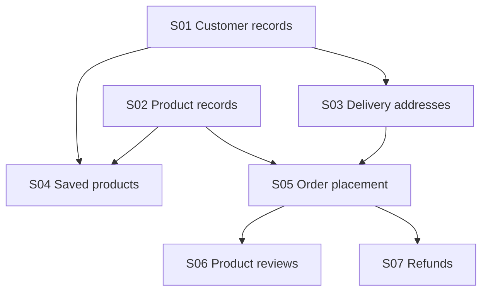

# Cycle Spec Template

A Cycle groups Stories for one planning window. It records order, dependencies, coordination, and risk. Each Story keeps its own requirements.

````md
---
id: cycle-01-<slug>
spec_language: en-US
window:
  - <planning-window>
---

## Planning Context

- <Why this work belongs in the same window.>
- <Ordering, coordination, or risk that matters to this plan.>
- <Checks of existing environments, permissions, or prerequisite results; none if unnecessary.>

## Story Plan

### Dependency Waves

#### Wave 1

1. `story-01-customer`: Customer records; start here so address entry can begin sooner.
2. `story-02-product`: Product records

#### Wave 2

1. `story-03-address`: Delivery addresses
2. `story-04-favorite`: Saved products

#### Wave 3

1. `story-05-order`: Order placement; begin when customer, product, and address results are ready. Saved products are not a prerequisite.

#### Wave 4

1. `story-06-review`: Product reviews
2. `story-07-refund`: Refunds

### Dependency Graph



## Repartition Records

<Optional. Keep only when entirely unstarted work has been repartitioned without changing its combined acceptance meaning.>

- Repartition: repartition-01
  - Spec Revision: rev-2
  - Before: [story-01-old, story-02-old]
  - After: [story-03-new, story-04-new]
  - Acceptance Map: story-01-old/A1-A2 -> story-03-new/A1-A2; story-02-old/A1 -> story-04-new/A1
  - Reason: <Why the new boundaries are easier to execute or accept independently.>

## Risks

- <A risk for this Cycle; none if there are no known risks.>
````

## Filling it in

Place `cycle.md` in a numbered Cycle directory, for example:

```text
spec/cycle-01-<slug>/cycle.md
```

### `spec_language`

Record the document language and regional usage, such as `en-US`, `ja-JP`, or `pt-BR`. A clear language name also works. Continue using an existing Cycle's setting. For a new Cycle without a language request, write `en-US`. See [spec language](./concept-model.md#spec-language).

Adapt the template's prose and examples to the selected language. Fixed headings, field names, enums, IDs, and filenames stay unchanged. New Stories and records use the Cycle's language.

### Planning Context

Explain why these Stories belong in this planning window and what matters to their order and coordination.

Prechecks describe existing environments, permissions, or prerequisite results. They do not replace the readiness check for each Story. Any setup, migration, or other implementation still needed for delivery must belong to a Story with its own acceptance conditions.

A Cycle can organize a release, a timebox, or a reporting period. Its Stories do not have to serve a single theme. Business rules and acceptance conditions belong in the individual Stories.

### Story Plan

Use `story-NN-<slug>` directories. Assign numbers after choosing boundaries, actual dependencies, and the first recommended order. Numbers remain stable once implementation or verification facts exist. Keep later priority changes in the plan and blocking facts in `depends_on`.

The plan has two sections:

- `Dependency Waves`: one occurrence of every Story, grouped by the longest prerequisite path. Use `#### Wave N` headings, ordered entries, and backticks around Story IDs. The CLI takes display titles from `Orientation/Title`.
- `Dependency Graph`: the generated dependency graph. It uses `SNN` labels and omits edges already implied by another path. With no dependencies, it contains `none`.

A Wave shows possible parallel work. It does not start a batch. Within a Wave, order by the value unlocked, main path, early risk discovery, feedback, workload, and available resources. A Story waits for its own prerequisites, not for every earlier Wave to finish.

Put a non-obvious coordination reason after the entry's semicolon or in a paragraph below it. Both forms stay with the Story during synchronization, including a move to another Wave. Notes explain timing or coordination; they do not repeat requirements, acceptance conditions, implementation steps, or dependency edges. They stay out of graph titles.

On the first draft, an ordered list of every Story is enough. Wave headings and titles can be omitted. Run:

```sh
nanospec validate --sync-views <cycle-dir>
```

The CLI computes Waves, adds titles, rebuilds the graph, and synchronizes the progress tree. Existing relative order inside a Wave stays intact. See the [CLI](./README.md#cli).

If the order within a Wave differs from Story numbering, explain a non-obvious reason without renumbering. The progress tree follows the expanded Wave order. Execution plans belong to the executing agent; useful repository findings can go in a Story's optional brief.

For a meaning-preserving repartition, every affected Story must be entirely unstarted, with no implementation, verification, or acceptance facts. Use new, unused IDs. Record the old and new IDs, current revision, complete Acceptance mapping, and reason. Never reuse retired numbers. A change to acceptance meaning follows the ordinary [change rules](./spec-change-rules.md).

Add reporting notes only when reporting is part of this Cycle's purpose.

### Start another Cycle when

- The work belongs to another planning window or release.
- It needs separate coordination or reporting.
- A different set of Stories has become a clearer plan.
- Keeping it here would make ordering and coordination hard to follow.
