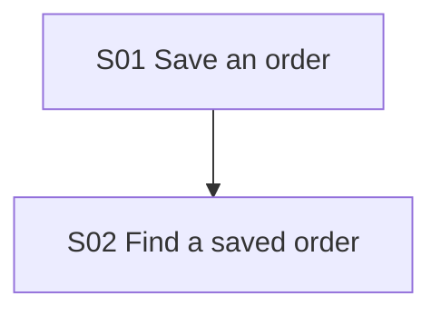

## Planning Context

- Add order entry and lookup as two results that can be accepted separately.
- Order lookup needs an actual saved order, so it follows order entry.

## Story Plan

### Dependency Waves

#### Wave 1

1. `story-01-save-order`: Save an order

#### Wave 2

1. `story-02-find-order`: Find a saved order

### Dependency Graph

## Risks

- none
