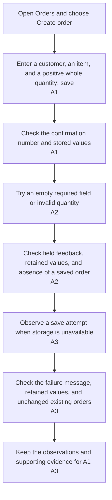

## Orientation

- Title: Save an order
- Scenario: 『Sales staff』 enters the 『customer name, item description, quantity』 and runs 「Save order」; a 『saved order number』 confirms which order was kept, while a failed save leaves the entered details available to correct or retry.

## Definition

### Description

Sales staff needs to keep the entered order details under a stable reference, so the confirmation can be checked against the saved record.

The Orders page offers a Create order entry with customer name, item description, and quantity. Saving a valid form creates one order containing those values and a unique order number. The confirmation appears only after the record has been stored and shows that number and the saved details.

If a field is invalid or storage fails, the form keeps its entered values and explains the problem. A failed attempt does not show a success confirmation or create a saved order.

### Business Logic

- Customer name and item description must each contain non-whitespace text.
- Quantity must be a positive whole number.
- Validation errors identify the invalid fields and prevent saving.
- A saved order number identifies one stored order and is not reused for another order.
- A storage failure leaves existing orders unchanged and keeps the current form available for retry.

## Out of Scope

- Stock allocation, payments, and shipping.
- Editing or deleting a saved order.
- Finding a saved order by its number.

## Acceptance

### Acceptance Flow

- [ ] A1: Saving valid details creates one stored order with the entered values and a unique order number shown in the confirmation.
- [ ] A2: Missing required text or a quantity that is not a positive whole number prevents saving, identifies the invalid fields, and keeps the entered values.
- [ ] A3: A storage failure shows a failure result, preserves the form and existing orders, and produces no success confirmation or saved order for that attempt.
