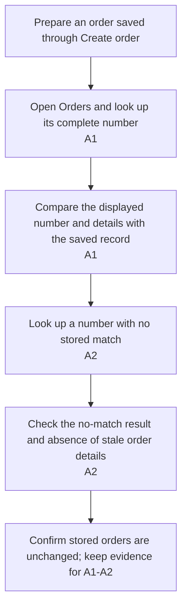

## Orientation

- Title: Find a saved order
- Scenario: With a 『saved order number』 from an earlier confirmation, 『Sales staff』 runs 「Find order」 on the Orders page; the matching 『order details』 make it possible to check what was saved without reentering the original form.

## Definition

### Description

When checking an earlier order, Sales staff needs to recover its saved details from the order number without rebuilding the original form.

Add an order-number lookup entry to the Orders page. The entry accepts a complete saved order number and looks for that exact number. A match shows the order number, customer name, item description, and quantity from the stored record created by Save an order.

When no order matches, show a clear no-match result without displaying details from a previous lookup. Looking up an order does not change any stored order.

### Integration Notes

Use the order number and stored fields delivered by story-01-save-order. That prerequisite supplies order creation; this Story adds lookup to the same Orders page.

## Out of Scope

- Partial-number search, editing, deletion, stock, payments, and shipping.

## Acceptance

### Acceptance Flow

- [ ] A1: Looking up a complete saved order number shows the matching stored number, customer name, item description, and quantity without changing the record.
- [ ] A2: A number with no match shows a no-match result, clears any previously displayed order details, and leaves stored orders unchanged.
