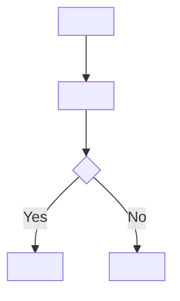
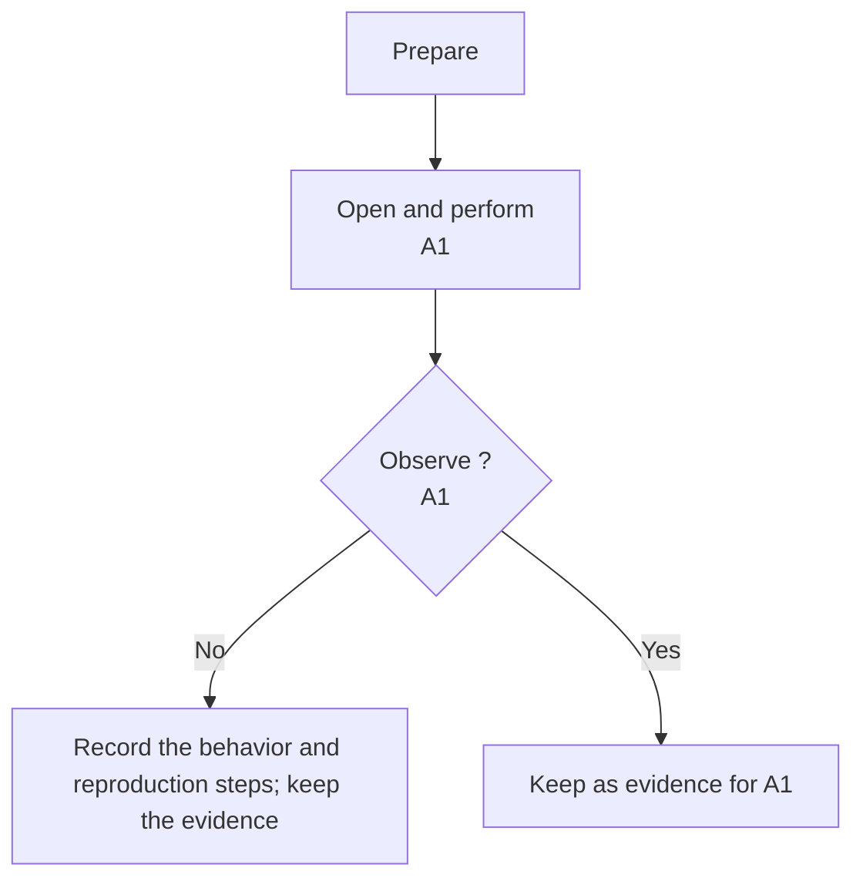

# Story Spec Template

A Story defines one result that can be understood, implemented, and accepted on its own. Write it in `story.md` inside its Story directory.

Use the Cycle's `spec_language` for title and scenario values, requirements, rules, decisions, acceptance, and diagram labels. Keep fixed headings, field names, enums, and identifiers unchanged. Adapt examples to the target language. The object and action markers keep their meaning; ordinary punctuation and word order follow the selected language. See [spec language](./concept-model.md#spec-language).

The Story must make sense without the planning conversation or another Story's prose. State the result, boundaries, inputs, outputs, and any use of prerequisite results. An issue summary, implementation action, or undefined business term is not enough.

Use the structure below. Replace the instructions with actual content and omit optional sections without useful content. Existing empty headings or `none` produce cleanup warnings; missing required content and wrong structure remain errors.

````md
---
id: story-01-<slug>
cycle: cycle-01-<slug>
depends_on: []
implementation_brief: none
---

## Orientation

- Title: <A short, specific name for the result.>
- Scenario: <One concrete event, told with warmth, care, and patience, from trigger to response and useful result. Mark complete objects with 『』 and clear business actions with 「」.>

## Definition

### Concepts

<Optional. Explain only business terms needed to understand or accept this result. Omit if none need explaining.>

### Description

<Define the result, the problem it solves, and the business value it provides. Describe the trigger, actual entry, participants, objects, process, defaults, and observable outcome. Explain which necessary parts are supplied here, already exist, or come from prerequisites. Keep the process readable; put precise decisions and boundaries in their appropriate sections. Include a local summary of any external material needed for implementation.>

### Business Logic

<Optional. State settled rules that determine the result and cannot be uniquely inferred from Description. Group them by actual business decision. Use prose, a decision table, a formula, a state model, or a flow as appropriate. Keep each rule in one primary form.>

#### State Model

<Optional. Define relevant states, events, conditions, transitions, prohibited transitions, recovery, and terminal behavior.>

#### Flow Diagram

<Optional. Use when the actual process, branches, state changes, or interactions need a diagram.>



#### Constraints

- <Optional. A specific wrong extrapolation to prevent, or a boundary that must remain unchanged.>

### UI Draft

<Optional. Include when the interface needs a structural sketch and no supplied design or reusable interface covers it.>


### Integration Notes

<Optional. Explain how this Story reads or connects to actual existing data, entries, buttons, links, APIs, or states.>

### Applicable Rules

- `<rule-id>`: <An applicable external business rule, with its concrete conditions, result, and exceptions.>

### Considerations

- <Optional. A grounded question about a cause, counterexample, or changing boundary worth checking during implementation.>

## Out of Scope

- <Optional. A nearby result this Story explicitly leaves unchanged.>

## Decision Ledger

### Confirmed Facts

- <A checked fact used by this Story.>

### Decisions

- <An adopted decision about behavior, scope, or a necessary boundary.>

### Assumptions

- <A temporary interpretation that implementation or acceptance may overturn.>

### Open Questions

- <A decision needed from a person whose answer changes behavior, boundaries, or acceptance.>

## Acceptance

### Acceptance Flow



- [ ] A1: <The key observable completion condition. Add A2, A3, and later IDs when other conditions determine whether the result is valid.>
````

## Filling it in

### 1. Frontmatter

#### `id`

Use `story-NN-<slug>`. The two-digit number is a stable reference for selection, coordination, and recovery. It does not encode priority or a blocking relationship.

For a new Cycle, settle boundaries, dependencies, and the first recommended order before assigning numbers. Once implementation or verification facts exist, keep the IDs. An entirely unstarted, meaning-preserving repartition can introduce unused IDs under the [change rules](./spec-change-rules.md#repartitioning-unstarted-stories), with a complete mapping and no reuse of retired numbers.

#### `cycle`

Use the complete ID of the Cycle directory containing this Story.

#### `depends_on`

List only direct prerequisites whose actual results are required for this result to stand. Use full Story IDs.

A preference, earlier number, recommended start order, or useful background does not establish a dependency. Put priority inside Dependency Waves. Waves show possible parallel work; the caller explicitly chooses whether to execute one or several Stories.

#### `regression_of`

Optional. A new Story fixing a regression can refer to accepted results:

```yaml
regression_of: [cycle-01-<slug>/story-01-<slug>]
```

The target must have both `story.md` and `acceptance/outcome.md`. Keep the original Story and Outcome frozen. Outcome's digest binds the accepted definition; preparation checks that binding and includes the old definition and result as read-only context.

The reference supplies traceability, not acceptance or a blocking dependency. Use `depends_on` separately when a real prerequisite exists.

#### `implementation_brief`

Use `none` when there is no useful brief, or `implementation-brief.md` when that file exists in the same directory.

The brief is optional repository context. Requirements, boundaries, rules, and acceptance must remain complete without it.

#### Acceptance policy and authority

Omit these fields by default. An omitted `acceptance_policy`, or `human`, requires an explicit human acceptance decision and does not use the other three fields.

When a prior instruction explicitly authorizes acceptance based on verification, supply all four:

```yaml
acceptance_policy: verified
acceptance_authority: <A traceable source of authority.>
acceptance_scope: <Covered Stories, Acceptance IDs, and limits.>
acceptance_review: <Who or what independently reviews acceptance and evidence coverage, and under what conditions.>
```

The executor's confidence, a low-risk label, or passed checks do not supply authorization. Independent verification must come from a verifier other than the implementer. A person can still accept a Story with this policy.

A changed policy or authority scope is a formal decision and increments `spec_rev`; it does not redefine Acceptance. Do not add these fields merely to fill out the template.

### 2. Orientation

Orientation gives a person a quick understanding. It contains only `Title` and `Scenario`, with values in the selected language.

`Title` is the short, specific official name of the result. Waves, graph, and overview take their display title from it. Keep one title source.

`Scenario` follows a representative event from its trigger through the system's contribution to a useful result. With a human participant, identify the role and entry. With a background process, identify the external input, scheduled event, or state change. The reader should understand what happens, what this Story provides, and how the result returns to the surrounding work.

Warmth and care come before structural markers. Write the natural explanation first, in a gentle, patient voice without unnecessary length. Notice the participant's situation, why the task begins, where repetition or uncertainty arises, what the system preserves or confirms, and how the next step can continue. Show at least one confirmed relationship:

- A changed state and its visible result.
- Unfinished work kept for a return visit.
- A repeated, easily missed, or uncertain step checked by the system.
- A result passed onward without someone having to reconstruct the same information.

Stay with the facts. Do not invent feelings, convenience, or benefits to make the scene warmer. Preserve the full strength of permissions, amounts, state rules, failures, and prohibitions.

#### Objects, actions, and clauses

Markers help readers find objects, conditions, actions, and results. Split by business logic rather than sentence length.

- `『』` marks a complete, identifiable role, data object, document, state, amount, record, or field that can actually be viewed, entered, edited, filtered, recorded, or referenced.
- It is not an emphasis marker. Generic words such as record, reason, result, state, data, and content should stay unmarked unless they are the complete, confirmed business name. Prefer an identified object such as `『posted payment』` or `『reversal reason』` when that is the actual name.
- Parallel objects may share one pair, as in `filter by 『date, account owner, customer, bank entry, matching ID, payment status』`. Keep each object identifiable. Do not mix conditions, actions, or explanations into that list.
- `「」` marks a clear business operation or behavior. Ordinary navigation and reading verbs do not need marks simply because they are verbs.
- Choose by meaning in the sentence: `view 『payment records』` identifies an object; `run 「Match payment」` identifies an action.
- Put a condition before its action. Use commas within one business action. Keep its direct result with it. Use a semicolon when moving to another relatively independent action.
- Identify the actor, condition, object, action, and result before marking them. Keep the original meaning and business terms. Add no unsupported facts.
- Use the fewest marks that help. Removing them should leave a natural explanation, not an operation log.

Example:

```text
『Finance』 filters 『posted payments』 by 『date, account owner, customer, bank entry, matching ID, payment status』; when a 『posted payment』 has not been used by 「Match payment」, Finance can enter a 『reversal reason』 and run 「Reverse the full payment」, restoring the 『unallocated bank-entry amount』.
```

A thin scenario says:

```text
After leaving the page, the 『applicant』 can 「Restore a draft」.
```

A more useful scene gives the surrounding work:

```text
While completing a 『funding request』, the 『applicant』 can leave and return without starting again; 「Restore a draft」 brings back the 『form values, saved receipts』 for the unfinished request.
```

An operation log says:

```text
The 『system』 receives the 『payment result』, updates the 『payment status』, and notifies 『Finance』.
```

A scene explains what that result does for the next person:

```text
When the 『payment result』 arrives, the 『system』 runs 「Update payment status」 and gives 『Finance』 a clear result to reconcile, without piecing together the same payment details again.
```

Common corrections:

- A condition is not an object: write `if requests arrive together or an upload fails`, not a marked list of concurrency and failure conditions.
- Identify the actual record and reason instead of marking `record` and `reason` for emphasis.
- Write `『Finance』 opens 『payment records』` rather than marking each navigation verb.
- Keep a natural action together: `the 『applicant』 selects a 『funding template』, enters the 『amount』, and runs 「Upload receipt」`.
- Without a page, start with the actual trigger: `At the 『daily settlement time』, the 『system』 runs 「Generate the settlement statement」 and saves the 『statement result』`.

A shared mechanism may use one representative business case, but that case must show the wider common purpose rather than quietly narrowing the Story. Avoid decorative metaphors, internal shorthand, and a compressed rewrite of Description. Keep the language thoughtful, concrete, and brief.

Orientation must agree with Definition, Out of Scope, decisions, and Acceptance. Resolve a conflict in the spec instead of treating the scenario as an exception.

### 3. Definition

Definition is the complete account of the required result. Description is its natural-language body. Explain the problem being solved and the value the result provides. Connect the trigger and actual entry, participating roles and system areas, objects and data, state changes, consumption, defaults, and observation points.

Explain which necessary parts this Story provides, which already exist, and which come from prerequisites. Turn source requirements into local, executable meaning. A link alone cannot replace it.

Put precise decisions, preconditions, state changes, failure outcomes, and exclusions in their appropriate sections instead of repeating a second rule list in Description.

#### Concepts

Explain business terms a competent developer or tester may not know and whose meaning affects implementation or acceptance. Use a short explanation, example, or comparison. No fixed count or separate glossary is required.

Keep terminology consistent across Stories, including accepted Stories. A project glossary can provide provenance, but a required local explanation still belongs here. Accepted Stories stay frozen.

Do not explain ordinary mechanisms such as browsers, retries, idempotency, snapshots, transactions, or locks unless their specific meaning changes the result. Ordinary actions such as submitting, attaching, approving, notifying, or synchronizing do not need a glossary entry merely because they appear in a Story.

Explain the term itself, not the full current workflow. For example:

> A reversal adds an opposite transaction to offset an earlier entry. Reversing 30 of an original credit of 100 is partial; reversing all 100 is a full reversal.

Then define this Story's actual reversal rules in Business Logic.

#### Business Logic

State confirmed rules about how facts, states, events, and conditions determine results, and which relationships must hold throughout. It does not prescribe the executor's thought process.

Omit the section when Description determines the rules completely. Keep it as a parent when State Model, Flow Diagram, or Constraints is needed. Do not repeat project-wide login or permission mechanisms without Story-specific meaning.

Group independent decision subjects under meaningful fourth-level business headings, before the dedicated State Model, Flow Diagram, and Constraints sections. A single simple subject can be stated directly.

For prose rules, state one definite proposition with the subject or object, condition or event, requirement strength, and result. For example:

```text
Only when <condition> may <actor> perform <action>.
When <event> occurs and <condition> holds, <object> must <result>.
Every <object> must preserve <relationship>.
<Actor> must not produce <result> under <condition>.
```

Choose the clearest form for the logic:

- A single condition, permission, obligation, or prohibition: explicit prose.
- Combinations of conditions with different results: a decision table with one definite result per combination.
- States and transitions that determine results: State Model.
- Amounts, ratios, ordering, or derived values: a formula with the units, precision, and selection rules that affect the result.
- Interactions or step relationships that are hard to follow in prose: Flow Diagram.

Keep each rule in one primary form. Use the same terms as Description. Equivalent conditions must not produce contradictory results. Do not restate a rule already uniquely determined there.

##### State Model

Use it when state transitions themselves affect the result: multiple states, prohibited transitions, cancellation, retries, recovery, terminal states, or role-specific transitions. A simple display, submit, or navigation action does not need a state machine for appearances.

##### Flow Diagram

Use a diagram for a meaningful process with important branches, multiple participants, external interactions, state transitions, or a sequence that would otherwise be easy to misread. Ordinary login, permission, empty-state, or error checks alone do not require a dedicated business flow diagram.

##### Constraints

Add a constraint only when the normal definition leaves a plausible wrong inference, that inference would materially change the result or unrelated scope, and the restriction cannot already be derived from the stated rules and project facts.

Describe the wrong outcome to prevent, an existing object that must remain untouched, or a relationship that must hold. Prefer constraining the outcome to choosing an internal implementation.

A new normal state, transition, or result belongs in Business Logic. An external stable rule belongs in Applicable Rules. An unsettled angle to investigate belongs in Considerations. Constraints is not a second checklist of the normal path.

#### UI Draft

Use a sketch when the Story involves an interface layout and no supplied design or directly reusable interface covers it.

Keep assets beside the Story:

```text
story-01-<slug>/
  story.md
  ui-draft.excalidraw
  ui-draft.svg
```

The sketch should show the main regions and elements, rough hierarchy and position, key states, actions, feedback, and transitions. Show important states within the visible canvas; a side or bottom state strip can help when there are several.

Use short labels. Keep the draft legible in a normal Markdown preview, thumbnail, or browser. Do not hide a key button or state at the edge of an oversized canvas. Link related pages with arrows when helpful. A desktop business screen can use rough navigation, content, and action areas to show hierarchy.

Reuse existing visual conventions. A structural difference does not require redrawing the entire visual system. Omit a duplicate sketch when a supplied design or reusable interface already explains the work.

#### Integration Notes

Explain how the current Story connects to actual existing data, entries, buttons, links, APIs, or states. The downstream Story owns this explanation.

A review feature can describe its use of existing customer and product records. Those earlier features do not need empty review placeholders.

#### Applicable Rules

Use the [rule selection rules](./rule-selection-rules.md). Keep only business rules that apply here and change behavior, interaction, or acceptance.

Include each stable ID and the local body, with conditions, results, strength, and exceptions needed for this Story. Keep useful checked source and version information once per source. Omit unrelated branches and background examples.

Do not include framework, directory, code-organization, or build requirements. Do not turn a suggestion into a hard constraint. Put unresolved conflicts with confirmed requirements in Open Questions. Omit the section when no rules apply.

#### Considerations

Keep grounded questions about causes, counterexamples, changing boundaries, and possible effects that deserve investigation. Useful questions can ask whether a conclusion still holds when data, state, timing, or a related object changes.

This is not another requirements section. Omit it when there is no worthwhile angle. Avoid reminders that fit every project, such as "consider performance and security", and move settled rules, decisions, or acceptance conditions to their proper places.

### 4. Out of Scope

State nearby results that might be wrongly included and are explicitly outside this Story. Omit an empty list. Do not enumerate every unmentioned feature or use an exclusion to hide a necessary rule.

### 5. Decision Ledger

Keep confirmed facts, decisions, assumptions, and required unresolved decisions in one place rather than leaving them in conversations or meeting notes.

Retain only sections with content, in the template's order. Omit the entire ledger if it adds nothing. A decision needed from a person that changes the delivery must remain in Open Questions.

When a decision defines behavior, write that behavior into Definition, Out of Scope, or Acceptance as well. The ledger keeps the decision itself.

Examples include a checked API field, an explicit product choice, a temporary interpretation of a state, or a disagreement between API documentation and an actual response still needing confirmation.

### 6. Acceptance

Acceptance names the observable facts that must hold when the Story is complete. Derive them from Definition without treating them as a replacement for the full requirements.

Start with the required `### Acceptance Flow` Mermaid diagram. It should identify preparation, roles and data, prerequisites, the actual entry, main and defined important non-success actions, what to observe, which ID each step covers, evidence to retain, and the next step after a pass or failure.

For a provider without its own page, identify the delivered call example, result, or persisted data that provides an actual observation entry. Do not invent an entry or command that does not exist.

Flow nodes must contain concrete operations and observations. Comments, style declarations, and subgraph titles do not count as coverage. Mark the covered Acceptance IDs in the nodes and cover every item. Do not add rules, prescribe internals, or prefill observations that have not happened.

Use stable IDs `A1`, `A2`, `A3`, and onward. Do not use `A0`, `QA1`, or hyphenated variants. The flow must cover all defined IDs and cannot refer to an undefined one. Include the outcomes that determine whether this Story stands; do not mechanically add one item per success, failure, empty-state, or regression category.

A useful condition describes what the page, API, data, or state shows after an actual action, or what business fact remains true under another defined condition. A person should be able to judge it without understanding the internal code structure.

File creation, function calls, command completion, a tool's status, and repeated requirement text do not replace an observable business condition.

When a confirmed, runnable check reduces repeated operations, reference it from the applicable item:

```md
- [ ] A1: <Observable business result.>
  - Checks: [check-save-order]

### Executable Checks

- Check: check-save-order
  - Run: `<actual-command-or-stable-check-entry>`
  - Environment: <Required services, data, accounts, and configuration.>
  - Expected: <The concrete expectation matching Acceptance.>
```

Use `check-<slug>` IDs. Several items can reference one check. Omit Checks and Executable Checks when there is no suitable entry. A check supplies repeatable operations and observations; it does not expand acceptance, replace local expectations, or grant final authority.

The executor performs all available flow steps within its environment and authority. Record unavailable permissions, inputs, or external conditions and keep the result pending. A person may repeat the route or review the evidence to accept or reject it. A `verified` policy can accept only within its declared authority, coverage review, and independent verification requirements.

Prepare the explicit selection before implementation. Use checkpoints for recovery state, evidence for observations, verification for review, and acceptance to freeze the record after the required decision. Do not prefill actual results or pass conclusions.

Validate the finished draft with `nanospec validate --sync-views <cycle-dir>`, then review its meaning with the [semantic checklist](./splitting-checklist.md).
